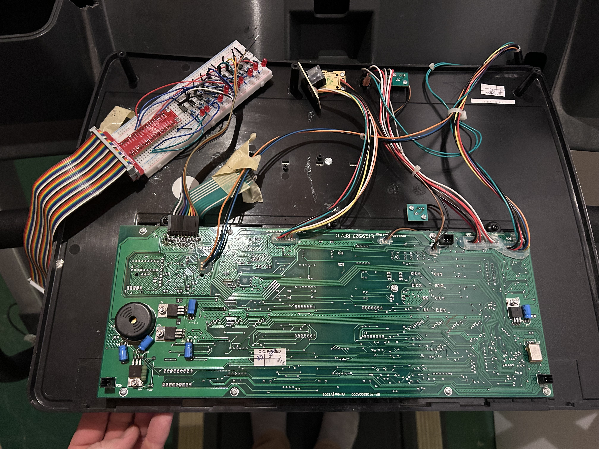
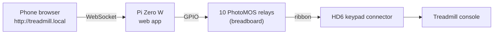
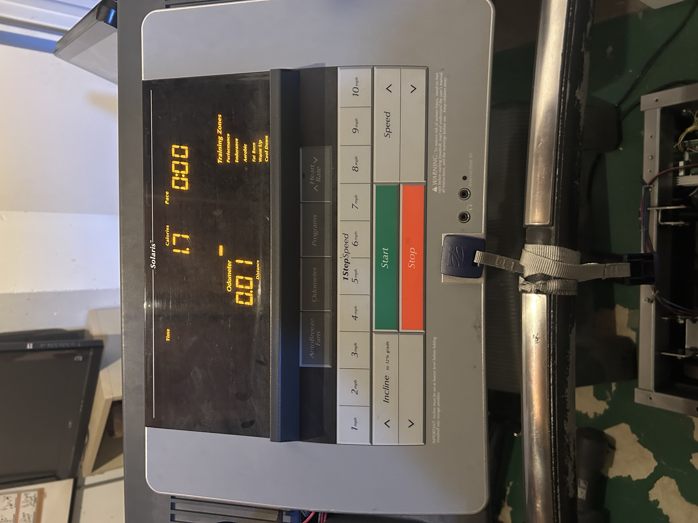
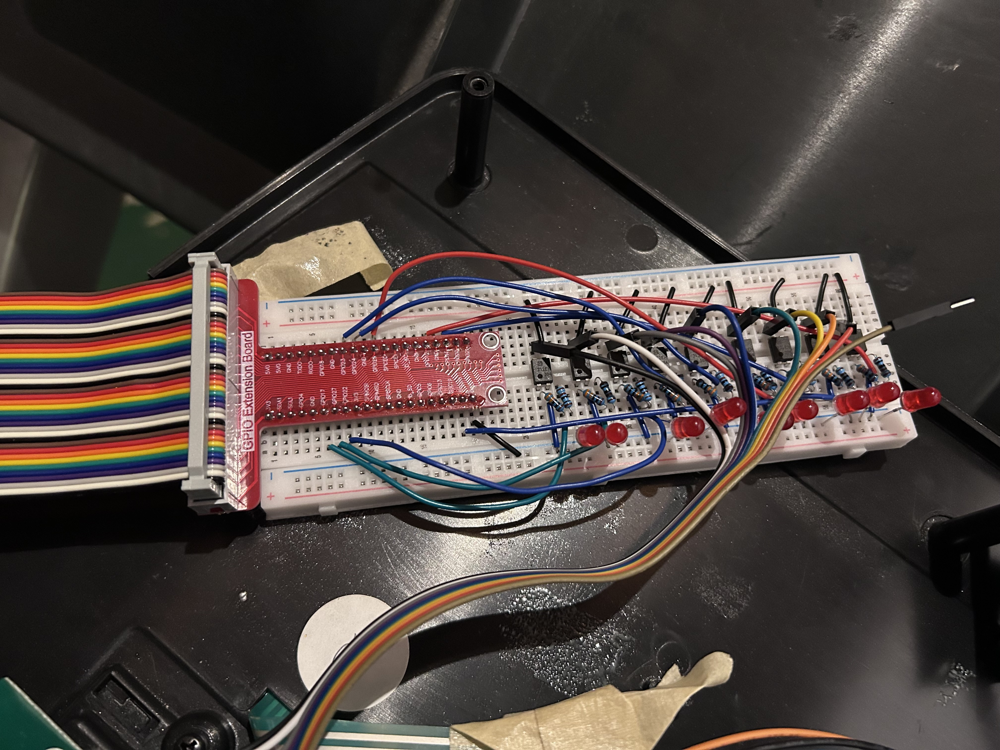
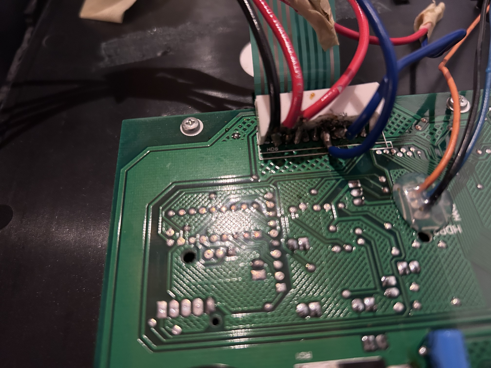
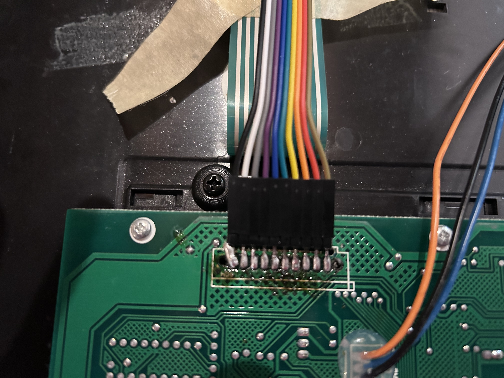

# Treadmill Controller

[](https://github.com/endoergic/treadmill-controller/actions/workflows/tests.yml)
[](LICENSE)
[](LICENSE-docs.md)

A Raspberry Pi Zero W that "presses" a treadmill console's keypad buttons, so any phone on the home Wi‑Fi can
control the treadmill from a small web page. It was built for a NordicTrack C2100 whose keypad stopped working:
instead of replacing the console, ten PhotoMOS relays are wired to the console's 10‑pin keypad connector (HD6) and
the Pi closes them in the same combinations the buttons would. The Pi has no electrical connection to the
treadmill, and the treadmill's own safety key still works as before.



*The console board (back side) with the rainbow ribbon plugged into the keypad connector HD6, and the relay
breadboard on the left. More photos: [Photos](#photos).*

> [!WARNING]
> **Safety. Read this before you open anything.**
>
> - The treadmill's motor controller (MC‑2100) carries mains voltage and high DC voltage for the motor.
>   **Only work on the console / keypad side.** Never open or probe the motor controller.
> - **Unplug the treadmill from the wall and wait** before you connect or disconnect anything.
> - **The physical safety key is the real stop.** The app's STOP button is a convenience. It goes through Wi‑Fi,
>   a queue and a relay, and it can fail. Keep the safety key clipped on while you walk.
> - Nobody on the belt during tests. Keep a hand on the safety key.
> - Use at your own risk. This project comes with **no warranty** (see [LICENSE](LICENSE)).

## Will this work on my treadmill?

It has been tested on **one** treadmill only:

| Part | Tested |
|------|--------|
| Treadmill | NordicTrack C2100, model NTL1085 |
| Console | Solaris |
| Motor controller | MC‑2100WA |
| Factory wiring diagram | Icon drawing #214876 (8/2004) |
| Pi | Raspberry Pi Zero W Rev 1.1, Raspberry Pi OS 13 "trixie" |

Many Icon / NordicTrack / ProForm consoles that use MC‑2100 motor controllers **may** use a similar keypad matrix.
This is unverified. To check yours:

1. **Measure the keypad connector** with a multimeter, as in
   [rewiring guide §2](docs/hardware/rewiring-guide.md#2-measure-first-10-minutes-multimeter). This circuit expects
   low‑voltage logic (about 3.3 V) on the keypad lines, ground pins, and no path to mains.
2. **Map your buttons** with `scripts/probe.py` once the relay board is built. It presses each line combination and
   logs what the console did. Put your results in `config/treadmill.toml`; the app's buttons come from that file.

## How it works



A button on the console grounds a combination of keypad lines 2–9. To press one, the Pi closes the relays for those
lines, waits 50 ms, then closes the "Go" relay (HD6 pin 1, console ground) for 300 ms and releases everything.
The relays isolate the Pi from the treadmill: the Pi only lights the LED inside each relay.
Details: [docs/architecture.md](docs/architecture.md) (software) and
[docs/hardware/rewiring-guide.md](docs/hardware/rewiring-guide.md) (circuit).

## Features

- Phones on the home Wi‑Fi open **http://treadmill.local**. LAN only, optional household PIN.
- Buttons: speed ±, START / STOP, 1–10 mph presets, incline ▲▼, fan, programs, odometer.
- All phones stay in sync: the server broadcasts state to every connected phone.
- Speed shown is an **estimate** (counted taps; presets jump it to their speed). There is no feedback from the console.
- Safety limits in the app: `max_speed` (taps and presets above it are refused and greyed out), a rate limit, and
  STOP that jumps the queue and is never rate‑limited.
- Buttons come from `[commands]` in the config, so a newly mapped command shows up without UI changes
  (unknown names become extra buttons).
- **Manual signals (troubleshooting panel, hidden):** tap "connected" at the top **5 times within 3 s**, or open
  `http://treadmill.local/#manual`. Pick any lines, a Go pin and a hold time (up to `max_press_ms`), then Press.
  It goes through the same queue and checks as the buttons (no ground pins as lines, `max_relays_on`, rate limit),
  doesn't change the speed estimate, and each press is logged in `journalctl -u treadmill`. The last 8 manual
  presses are kept on the phone for one‑tap repeats.
- Static files are served with `Cache-Control: no-cache`, so after a deploy a normal page reload picks up the new UI.
- Starts on boot as a systemd service.

## What you need

A Raspberry Pi Zero W (with header), 10 Panasonic AQY212EH PhotoMOS relays, resistors, LEDs, a full‑size breadboard,
a 40‑pin T‑type GPIO breakout (Adafruit T‑Cobbler Plus or a generic "GPIO Extension Board"), jumper wires, a 1×10
header and Dupont housing, and a multimeter. Full list:
[docs/hardware/shopping-list.md](docs/hardware/shopping-list.md)
(printable: [hardware/shopping-list.html](hardware/shopping-list.html)).

## Build path

Do these in order:

1. **Buy the parts:** [shopping list](docs/hardware/shopping-list.md).
2. **Build the relay board:** [breadboard build](docs/hardware/breadboard-build.md) (kid‑friendly, one soldering
   job). Picture: [hardware/breadboard-layout.svg](hardware/breadboard-layout.svg); schematic:
   [hardware/schematic.svg](hardware/schematic.svg).
3. **Set up the Pi:** [docs/setup-pi.md](docs/setup-pi.md), from a blank SD card to the web app running.
4. **First test:** bench test with `scripts/relay_test.py`, then a first live press
   ([setup-pi.md → Bench test](docs/setup-pi.md#8-bench-test-no-treadmill) and
   [First live press](docs/setup-pi.md#9-first-live-press)).
5. **If your console differs:** map your buttons with `scripts/probe.py`
   ([rewiring guide §9](docs/hardware/rewiring-guide.md#9-discovery-mode)) and update `config/treadmill.toml`.

## Docs

| Doc | What's in it |
|-----|--------------|
| [docs/setup-pi.md](docs/setup-pi.md) | Pi setup, from a blank SD card to the first press |
| [docs/architecture.md](docs/architecture.md) | Software modules, WebSocket protocol, queue and safety rules, config keys |
| [docs/hardware/breadboard-build.md](docs/hardware/breadboard-build.md) | Step‑by‑step breadboard build |
| [docs/hardware/shopping-list.md](docs/hardware/shopping-list.md) | Parts to order |
| [docs/hardware/rewiring-guide.md](docs/hardware/rewiring-guide.md) | The circuit explained, measurements, timing, discovery |
| [docs/hardware/button-map.md](docs/hardware/button-map.md) | Reverse‑engineered keypad map and measurements |
| [docs/charter.md](docs/charter.md) | Goals, scope, constraints, risks |
| [docs/tech-stack.md](docs/tech-stack.md) | Stack choices for the Pi Zero W and why |
| [hardware/schematics/](hardware/schematics/README.md) | Hand‑drawn switch wiring and the factory diagram |

## Photos

| | |
|---|---|
|  |  |
| The Solaris console the app drives | The relay board (wire colors differ from the layout picture; follow the picture) |
|  |  |
| HD6 before: the half‑melted socket | HD6 after: new header and rainbow plug (black = pin 1) |

## Repository layout

```
treadmill-controller/
├── .github/                    # CI (tests on every push), compatibility-report issue form
├── README.md
├── CHANGELOG.md
├── LICENSE                     # MIT (code)
├── LICENSE-docs.md             # CC BY 4.0 (docs, pictures, photos)
├── requirements-dev.txt        # laptop dev/test dependencies
├── app/
│   └── treadmill/              # Python package (the web app)
│       ├── main.py             # Starlette app + uvicorn entry point, WebSocket /ws
│       ├── config.py           # loads + validates the TOML config
│       ├── relays.py           # PhotoMOS relay driver (gpiozero)
│       ├── controller.py       # command queue, estimated speed, limits
│       └── static/             # index.html, app.js, style.css (phone UI)
├── config/
│   └── treadmill.example.toml  # HD6 pin → GPIO map, commands, limits, timings
├── deploy/
│   ├── install.sh              # one-time Pi setup: apt packages + systemd service
│   └── treadmill.service       # systemd unit template
├── scripts/
│   ├── relay_test.py           # light show: each relay on, one at a time
│   └── probe.py                # discovery: press any combination, log what the console did
├── tests/                      # pytest, runs against gpiozero's mock pins
├── docs/
│   ├── setup-pi.md
│   ├── architecture.md
│   ├── charter.md
│   ├── tech-stack.md
│   └── hardware/
│       ├── breadboard-build.md
│       ├── shopping-list.md
│       ├── rewiring-guide.md
│       ├── button-map.md
│       └── discovery-log.csv   # raw probe answers
└── hardware/
    ├── schematic.svg           # relay board schematic
    ├── breadboard-layout.svg   # printable breadboard picture
    ├── shopping-list.html      # printable shopping list
    ├── schematics/             # hand-drawn switch wiring, factory diagram
    └── photos/                 # console connector and build photos
```

## Development

No hardware needed: gpiozero's mock pin factory stands in for the GPIOs.

```bash
python3 -m venv .venv
.venv/bin/pip install -r requirements-dev.txt
.venv/bin/python -m pytest

# Run the app on a laptop, then open http://localhost:8000
GPIOZERO_PIN_FACTORY=mock PYTHONPATH=app .venv/bin/python -m treadmill.main --port 8000
```

`tests/conftest.py` sets `GPIOZERO_PIN_FACTORY=mock` for the tests.

## Deploy and update

First install: [docs/setup-pi.md](docs/setup-pi.md). After that, from the repo folder on your laptop
(replace `pi` with your username on the Pi):

```bash
rsync -a --relative --exclude __pycache__ scripts config app deploy tests pi@treadmill.local:treadmill-controller/
ssh pi@treadmill.local sudo systemctl restart treadmill

# Bring discovery answers back from the Pi
rsync -a pi@treadmill.local:treadmill-controller/docs/hardware/discovery-log.csv docs/hardware/
```

Reload the page on the phone to get the new UI.

## Known limitations

- Speed is open‑loop: the app counts presses and never reads the console. The estimate can drift.
- Only tested on one treadmill (above).
- Heart Rate ▲▼ is not mapped.
- `max_speed = 6.0` is a placeholder chosen at project start, not a measured value.
- Not measured: the console's minimum and maximum speed, the shortest Go press that registers, and what happens
  when the safety key is pulled and reinserted.
- No auto‑stop when all phones disconnect.
- Breadboard build only; a soldered version is suggested but not built.

Full list: [CHANGELOG.md](CHANGELOG.md).

## License

- Code: [MIT](LICENSE).
- Docs, pictures and photos: [CC BY 4.0](LICENSE-docs.md).

## Status

**v1.0.1**. All mapped commands were confirmed on the tested treadmill on 2026-11-14. See [CHANGELOG.md](CHANGELOG.md).

Got it working (or not) on another treadmill? Please file a
[compatibility report](https://github.com/endoergic/treadmill-controller/issues/new?template=compatibility.yml).
Build questions go to [Discussions](https://github.com/endoergic/treadmill-controller/discussions).
