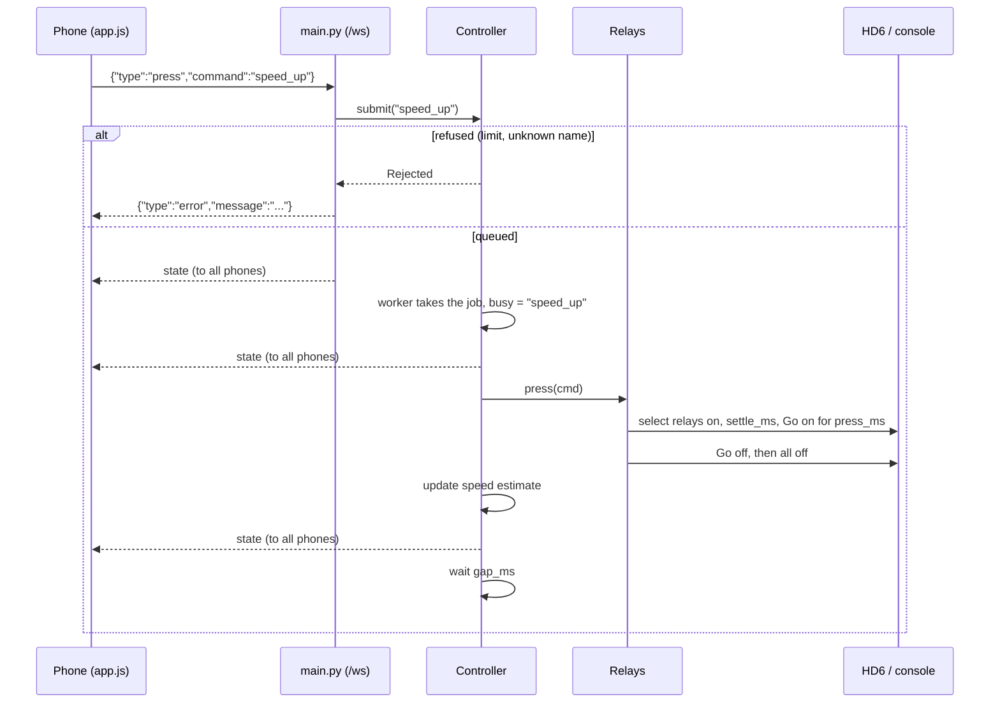

# Software architecture

One Python process on the Pi: a Starlette web app with one asyncio event loop. It serves the phone UI, keeps one
WebSocket per phone, and presses keypad buttons through a single worker queue. Stack rationale:
[tech-stack.md](tech-stack.md). Circuit: [hardware/rewiring-guide.md](hardware/rewiring-guide.md).

## Modules

| File | Responsibility |
|------|----------------|
| `app/treadmill/config.py` | Loads the TOML config (`config/treadmill.toml`, else `config/treadmill.example.toml`) into frozen dataclasses (`Config`, `Command`) and validates it. |
| `app/treadmill/relays.py` | `Relays`: one gpiozero `DigitalOutputDevice` per HD6 pin. `press()` performs one tap. Backend is lgpio on the Pi, or the mock pin factory when `GPIOZERO_PIN_FACTORY=mock`. |
| `app/treadmill/controller.py` | `Controller`: job queue and single worker, estimated speed, `max_speed` and rate limit, STOP priority, manual jobs, state broadcast to subscribers. |
| `app/treadmill/main.py` | Starlette app: static UI, WebSocket endpoint `/ws`, optional PIN check, lifespan (creates `Relays` + `Controller`, releases everything on shutdown), CLI entry point (`--config`, `--host`, `--port`). |
| `app/treadmill/static/` | Phone UI: `index.html`, `app.js`, `style.css`. No build step. |
| `scripts/relay_test.py` | Bench light show: each relay on, one at a time. Reads the GPIO map from the config. |
| `scripts/probe.py` | Discovery: presses line combinations and logs the console's answers to `docs/hardware/discovery-log.csv`. Stops/starts the service with `sudo -n`. |

## Data flow

Every change is followed by a broadcast of the full state to every connected phone, so all phones show the same
speed, busy command and queue.

## WebSocket protocol

Endpoint: `/ws`. Messages are JSON text frames.

If `[server] pin` is set, the client must connect as `/ws?pin=<PIN>`. A wrong or missing PIN closes the socket with
code **4001**, which the UI treats as "ask for the PIN". The comparison uses `hmac.compare_digest`.

### Client → server

| Message | Effect |
|---------|--------|
| `{"type": "press", "command": "speed_up"}` | Queue a config command by name. |
| `{"type": "reset"}` | The user says the belt is stopped (for example, safety key pulled): speed estimate → 0, pending jobs dropped. |
| `{"type": "manual", "select": [4, 6], "go": 1, "press_ms": 300}` | Troubleshooting panel: press any lines + Go pin, held for `press_ms`. |

### Server → client

| Message | When |
|---------|------|
| `{"type": "state", ...}` | On connect, after every accepted message, before and after each press, and when a phone connects or disconnects. Sent to all phones. |
| `{"type": "error", "message": "..."}` | A message was refused or malformed. Sent only to the phone that sent it. |

### State fields

| Field | Meaning |
|-------|---------|
| `speed` | Estimated speed, rounded to 0.1. |
| `unit` | `[speed] unit` (e.g. `"mph"`). |
| `max_speed` | `[safety] max_speed`. |
| `busy` | Name of the job being pressed now, or `null`. |
| `queued` | Names of pending jobs, in order. |
| `commands` | All command names from `[commands]`. The UI builds its buttons from this; unknown names become extra buttons. |
| `presets` | `{command name: sets_speed}` for commands that have `sets_speed`. |
| `clients` | Number of connected phones. |
| `manual` | For the troubleshooting panel: `pins` (all HD6 pins with a GPIO), `ground`, `press_ms`, `max_press_ms`, `max_relays_on`. |

Manual job names look like `manual 4+6, Go 1, 300 ms`.

## Controller rules

**Single worker.** One asyncio task presses jobs one at a time, with `gap_ms` between them. Two phones can never
produce overlapping half-presses.

**STOP.** A command named `stop` clears the queue, is appended as the only pending job, and is never rate-limited or
speed-checked. It runs as soon as the current press (at most `max_press_ms`) finishes.

**Rate limit.** At most `max_commands_per_sec` accepted submissions (commands and manual presses) in any rolling
1-second window. Extra taps get the error "too many taps, slow down".

**Speed estimate (open loop).** The app never reads the console. After each press:

| Job | New estimate |
|-----|--------------|
| `speed_up` | `start_speed` if stopped, else `+ step` |
| `speed_down` | `- step`, not below 0 |
| `start` | `start_speed` if stopped, else unchanged (the console beeps an error while running) |
| `stop` | 0 |
| command with `sets_speed` (presets) | `sets_speed` |
| manual job, any other command | unchanged |

**max_speed.** Before queuing, the controller replays the job being pressed now, every queued job and the new job
on the current estimate. If the result is above `max_speed`, the job is refused. So queued taps count, and a preset
above `max_speed` is refused (the UI greys it out).

**Reset.** `reset` clears the queue, sets the estimate to 0 and bumps a generation counter. A press already in flight
when the reset arrives does not update the estimate afterwards.

**Manual jobs.** Checked before queuing: no ground pins as select lines, `0 < press_ms ≤ max_press_ms`, then the same
validation as a config command (pins must have a GPIO, Go not in select, at most `max_relays_on` relays). They pass
the rate limit, are logged at INFO level (visible in `journalctl -u treadmill`), and never change the estimate.

## Press sequence and fail-open behaviour

`Relays.press()`:

1. Close every select relay.
2. Wait `settle_ms`.
3. Close the Go relay.
4. Wait `press_ms` (or the manual job's hold time).
5. In a `finally` block: open Go first, then open every relay.

Go is released first so the console never sees the select lines drop while Go is still closed. Because the release is
in `finally`, a cancelled or failing press still opens everything.

Other fail-open points:

- Every output is created with `initial_value=False`: all relays start open.
- The GPIOs used default to pull-down at boot, so nothing is pressed while the Pi boots.
- On shutdown the lifespan handler stops the worker, releases all relays and closes the devices.
- An unpowered Pi lights no relay LED, so every relay is open.

## Config

`config/treadmill.toml` if present, else `config/treadmill.example.toml`. Override with `--config PATH`. GPIO numbers
are BCM. `config.validate()` refuses a config where two HD6 pins share a GPIO, `press_ms > max_press_ms`, a command
selects a ground pin, uses a pin without a GPIO, has Go in its select list, closes more than `max_relays_on` relays,
or has `sets_speed ≤ 0`.

| Key | Example | Meaning |
|-----|---------|---------|
| `[server] host` | `"0.0.0.0"` | Listen address. `--host` overrides. |
| `[server] port` | `80` | Listen port. `--port` overrides. |
| `[server] pin` | `""` | Optional household PIN. Empty = no PIN. |
| `[hd6] ground` | `[1, 10]` | Console ground pins (Go side). Never allowed as select lines. |
| `[hd6.gpio] <pin> = <bcm>` | `1 = 17` … `10 = 13` | HD6 pin → BCM GPIO driving that pin's relay. |
| `[timing] settle_ms` | `50` | Select relays closed → wait → Go. |
| `[timing] press_ms` | `300` | Go held for one tap. Keep well under ~1000: the console auto-repeats after ~1 s. |
| `[timing] max_press_ms` | `5000` | Longest Go hold; limit for manual presses. |
| `[timing] gap_ms` | `200` | Pause between consecutive jobs. |
| `[timing] max_relays_on` | `5` | Most relays closed at once (GPIO current budget, ~6 mA per relay). |
| `[safety] max_speed` | `6.0` | App speed limit. Placeholder, not measured; the console itself goes to 10 mph. |
| `[safety] max_commands_per_sec` | `3` | Rate limit. |
| `[speed] unit` | `"mph"` | Display unit. |
| `[speed] step` | `0.1` | Estimate change per speed tap. |
| `[speed] start_speed` | `1.0` | Speed after `speed_up` or `start` from stopped. |
| `[commands] <name> = { select, go, sets_speed }` | `speed_up = { select = [2, 7], go = 1 }` | One button: `select` = HD6 lines to close, `go` = Go pin, optional `sets_speed` = preset speed for the estimate. |

The names `speed_up`, `speed_down`, `start`, `stop` have special meaning in the estimate and `stop` gets priority.
The command map is documented in [hardware/button-map.md](hardware/button-map.md#commands).

## Static files and caching

`/` serves `app/treadmill/static/` (`index.html` for `/`). Responses carry `Cache-Control: no-cache`: browsers
revalidate on every load (a cheap 304 on the LAN). Without it, browsers cached `app.js` heuristically and kept running
the old UI after a deploy.

The troubleshooting panel opens when "connected" is tapped 5 times within 3 s, or at `/#manual`. It keeps the last 8
manual presses on the phone.

## systemd service

`deploy/install.sh` (run with `sudo`) installs the apt packages, renders `deploy/treadmill.service` with the invoking
user and the repo folder, installs it as `/etc/systemd/system/treadmill.service`, enables it and restarts it.

| Unit setting | Value |
|--------------|-------|
| `User` / `WorkingDirectory` | The user who ran `sudo`, and the repo folder |
| `Environment` | `PYTHONPATH=app` |
| `ExecStart` | `/usr/bin/python3 -m treadmill.main` |
| `Restart` | `on-failure`, `RestartSec=2` |
| `AmbientCapabilities` | `CAP_NET_BIND_SERVICE` (port 80 without root) |

Logs go to journald: `journalctl -u treadmill -f`. The service owns the GPIOs, so stop it before running
`scripts/relay_test.py`.

## Tests

`tests/test_controller.py`, 13 tests with pytest. `tests/conftest.py` sets `GPIOZERO_PIN_FACTORY=mock` and puts
`app/` on `sys.path`, so no hardware is needed. They cover:

- press order (select before Go) and release of every relay, including when a press is cancelled mid-way;
- STOP clearing the queue and bypassing the rate limit;
- `max_speed` counting queued taps; presets setting the estimate and being refused above `max_speed`;
- in-order presses and speed tracking; `start` only moving the estimate from stopped;
- a reset during a press not being overwritten;
- manual presses: refused when unsafe, Go held for their own time, estimate unchanged.

Run: `.venv/bin/python -m pytest` (setup in the [README](../README.md#development)).
